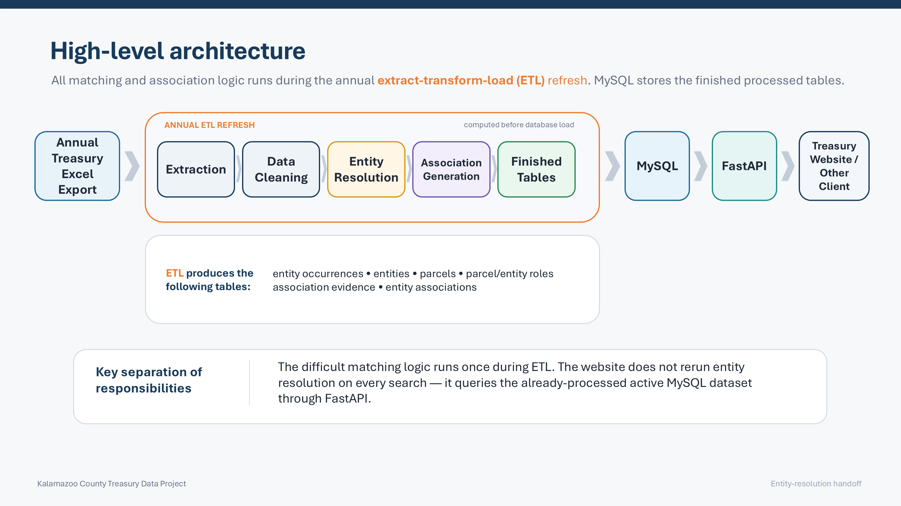
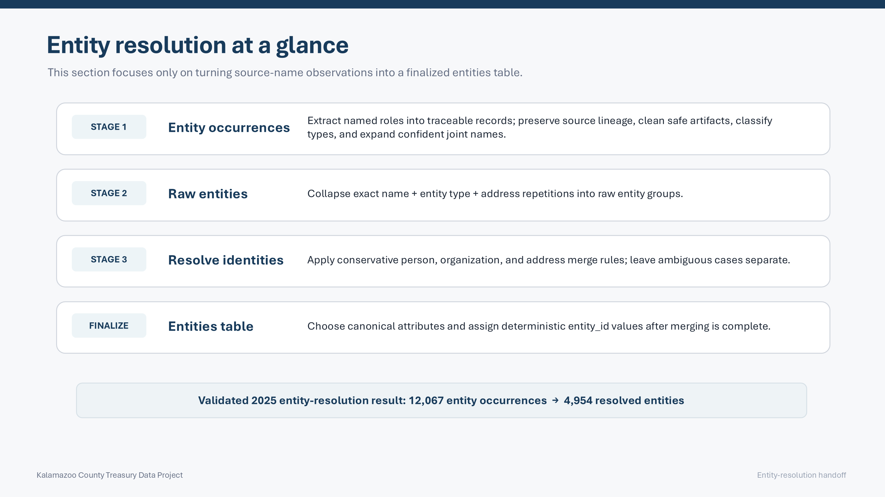
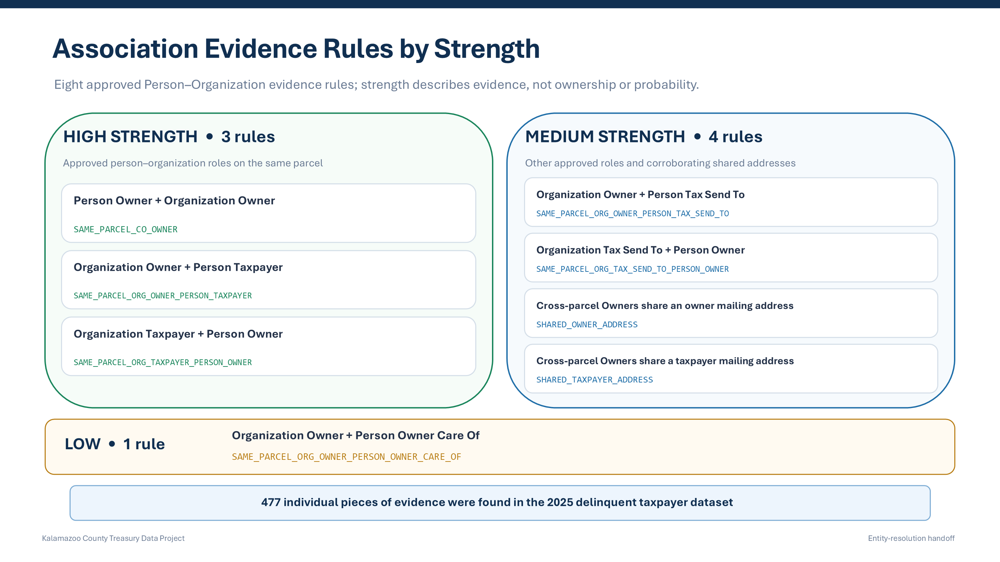
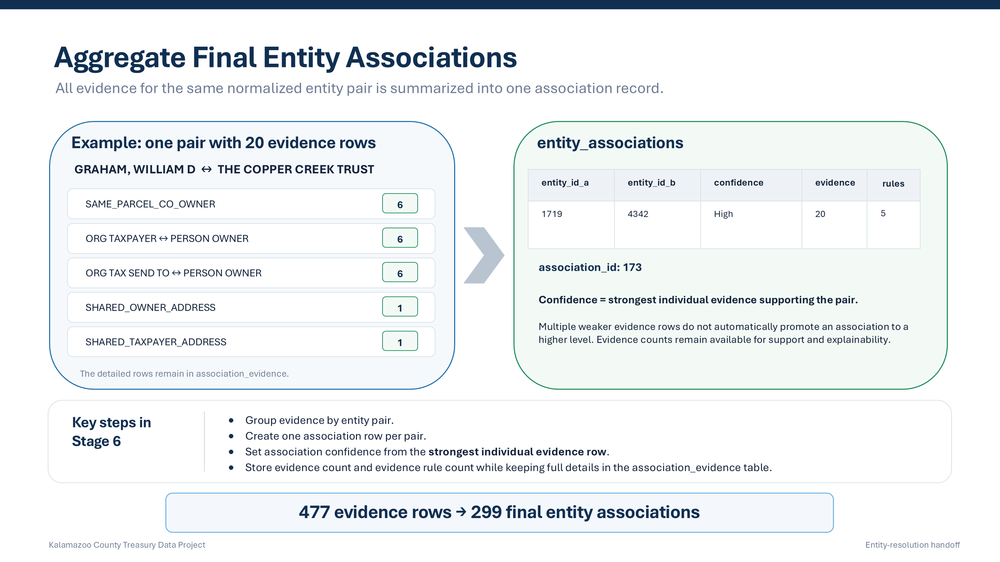
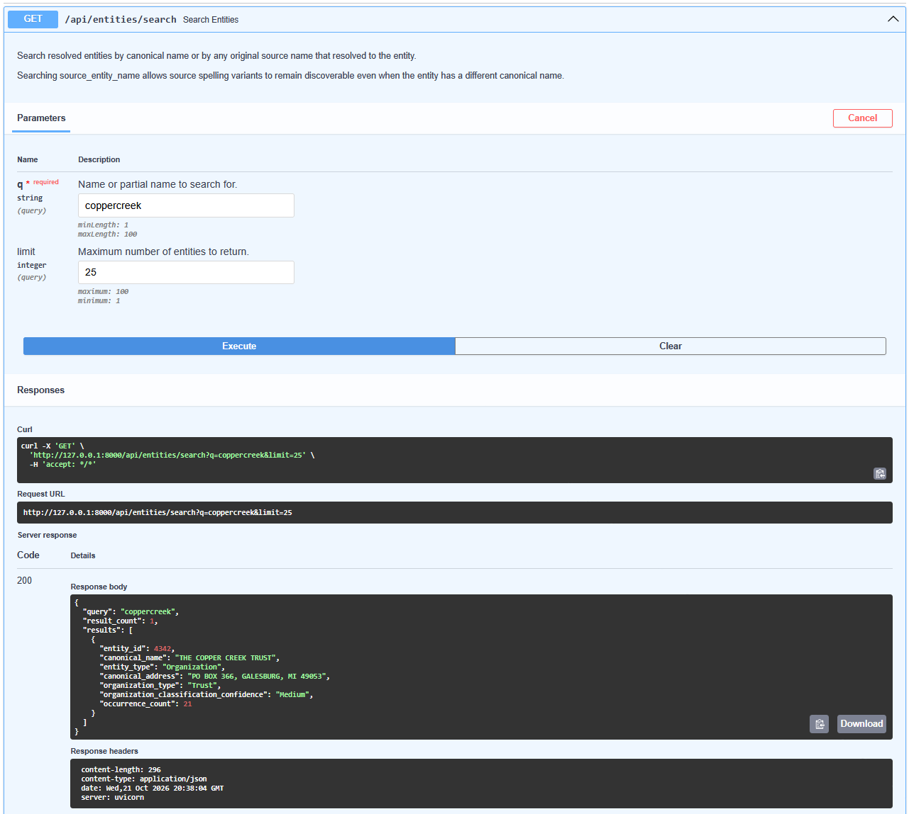
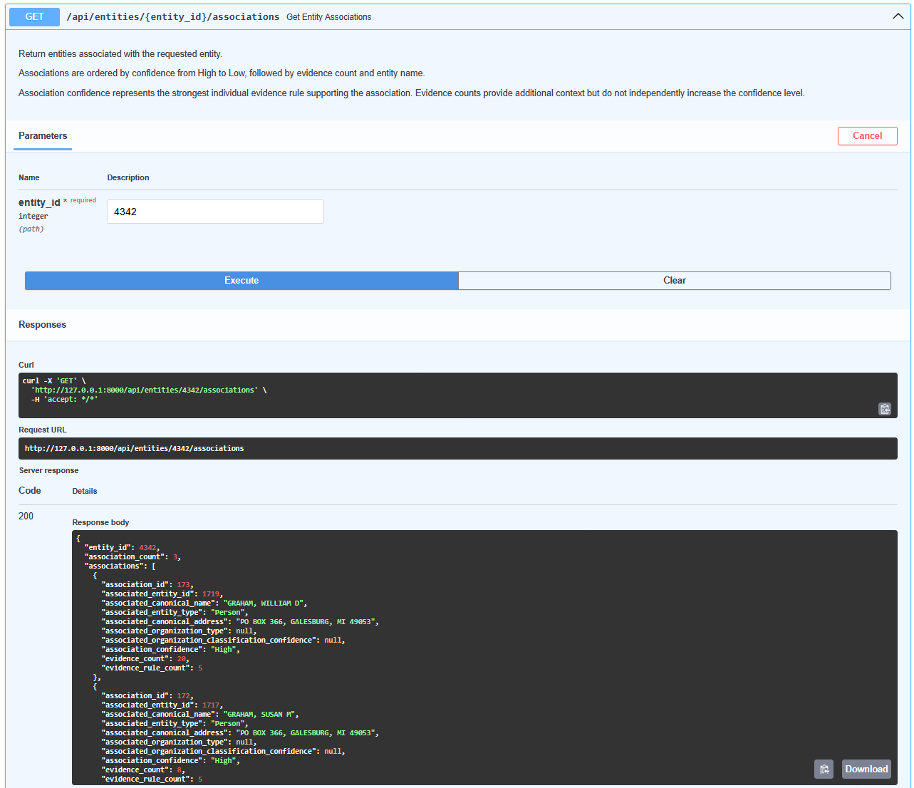
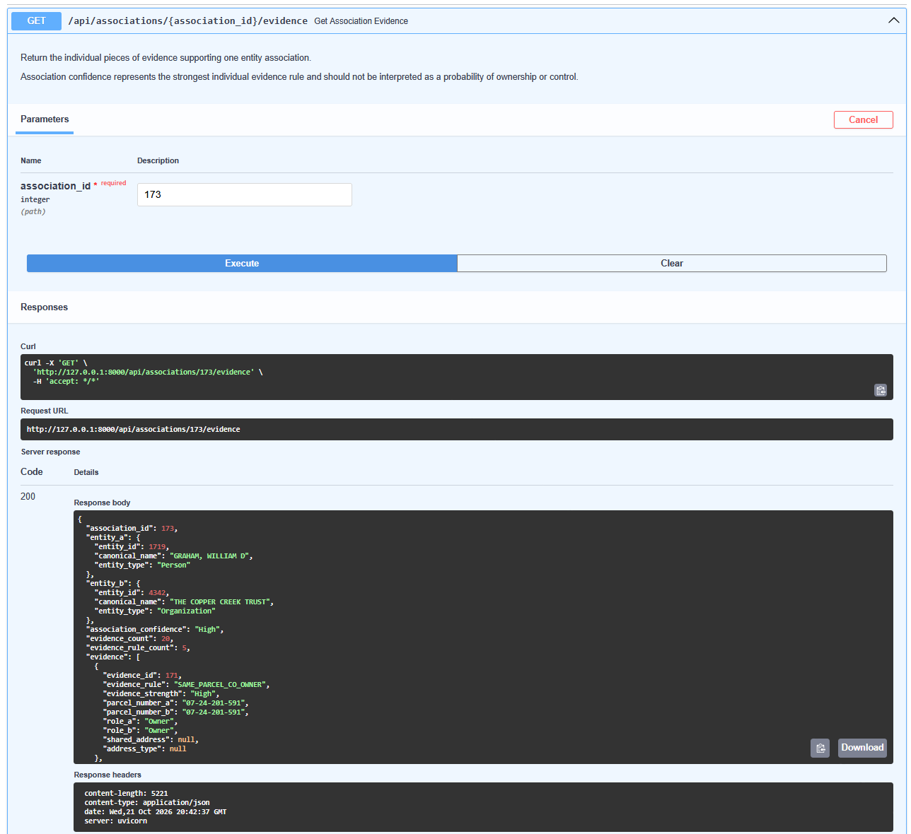

# Kalamazoo County Treasury
### Entity Resolution & Parcel Research System

**Python · pandas · MySQL · SQLAlchemy · FastAPI · pytest**

An end-to-end data processing and search application developed for Kalamazoo County Treasury to support research into connections between people, organizations, and delinquent-property-tax parcels.

The system transforms annual Excel exports into a normalized relational database, resolves repeated and inconsistent entity names, identifies evidence-backed associations, and makes the results accessible through a REST API.

## Project at a Glance

| **3,874** | **4,954** | **299** | **67** |
|:---:|:---:|:---:|:---:|
| Parcels Processed | Resolved Entities | Evidence-Backed Associations | Automated Tests Passed |

*Results from the validated 2025 Kalamazoo County Treasury dataset.*

## My Contributions

- **ETL Development:** Built a reusable Python pipeline for extracting, cleaning, transforming, and validating annual parcel datasets.
- **Entity Resolution:** Developed conservative, rule-based methods to identify repeated people and organizations across inconsistent names, addresses, and recorded roles.
- **Database Design:** Designed and populated a normalized MySQL database with entity, parcel, relationship, and supporting-evidence tables.
- **API Development:** Built a FastAPI REST API for searching entities, retrieving associated parcels, and examining evidence-backed associations.
- **Testing & Validation:** Implemented automated tests, data-integrity checks, and transaction-protected annual refreshes.
- **Project Handoff:** Documented the system and presented the completed development project to Kalamazoo County Treasury stakeholders.

## Project Status

**Development completed and handed off — October 2026**

The data-processing pipeline, relational database, API, and automated tests have been completed and validated. The project has been delivered to Kalamazoo County Treasury for potential deployment and integration with County systems.

Production hosting, authentication integration, and public website integration remain separate County deployment activities.

> **Important:** Entity associations are research leads derived from parcel, name, role, and address evidence. They do not establish legal ownership, beneficial ownership, control, or identity.


## Architecture Diagram

The system uses an end-to-end ETL pipeline to transform annual Treasury Excel exports into a structured, searchable MySQL database. Data extraction, cleaning, entity resolution, and association generation occur before the validated results are loaded into the database. FastAPI then provides access to the processed data for future integration with County applications or websites.



## Entity Resolution

The pipeline first converts individual name observations into traceable records, then consolidates repeated representations using conservative, deterministic matching rules. Ambiguous records are left separate rather than forcing potentially incorrect matches.



## Association Generation

The system identifies potential connections between people and organizations using eight predefined evidence rules, including shared parcel ownership, taxpayer relationships, and common mailing addresses. Each supporting piece of evidence is retained, allowing users to understand why an association was generated.



Individual evidence records are consolidated into unique person–organization associations, each assigned a High, Medium, or Low confidence category based on its strongest supporting evidence. These associations serve as explainable research leads rather than definitive conclusions about ownership or control.



## Example API Demonstration

The following example demonstrates how the system allows Treasury staff to search for a person, retrieve associated parcels, identify potential organizational connections, and inspect the evidence behind those connections.

This demonstration uses the validated 2025 Kalamazoo County Treasury dataset.

### 1. Search for an Entity

**Endpoint:** `GET /api/entities/search?q=coppercreek`

The API searches normalized entity names and original source-name variants. In this example, the search returns **THE COPPER CREEK TRUST**, a resolved Organization entity with ID `4342`.



### 2. Identify Potential Associations

**Endpoint:** `GET /api/entities/4342/associations`

The system identifies an evidence-backed association between **GRAHAM, WILLIAM D** and **THE COPPER CREEK TRUST**.

The association has:

- **Confidence category:** High
- **Supporting evidence records:** 20
- **Distinct evidence rules:** 5



### 3. Examine Supporting Evidence

**Endpoint:** `GET /api/associations/173/evidence`

Rather than returning an unexplained association, the API exposes the individual evidence records that support it.

Evidence includes relationships involving shared parcels, recorded ownership and taxpayer roles, and shared mailing addresses.



> **Interpretation:** Association confidence is a qualitative category based on the strongest supporting evidence rule, not a statistical probability. Associations are research leads and do not establish legal ownership, beneficial ownership, or control.

**Note:** Entity and association IDs refer to the validated 2025 dataset and may change following future data refreshes. The screenshots show the locally hosted development API; a publicly deployed API is not currently available.

For complete endpoint details, see the [API Reference](docs/api-reference.md).

## Documentation

The sections above provide an overview of the project's purpose, architecture, and results. More detailed technical documentation is available below.

| Document | Description |
|---|---|
| [System Architecture](docs/architecture.md) | ETL pipeline, entity resolution, association generation, and design principles. |
| [Database Documentation](docs/database.md) | Database schema, generated and persistent tables, and snapshot management. |
| [Installation & Setup](docs/setup.md) | Dependencies, MySQL setup, database accounts, environment configuration, and running the API. |
| [API Reference](docs/api-reference.md) | Read-only and administrative API endpoints, request formats, and authentication considerations. |
| [Annual Data Refresh](docs/annual-refresh.md) | Processing new annual datasets, validation, snapshot codes, and transactional rollback protection. |
| [Testing & Validation](docs/testing.md) | Automated tests, validated 2025 baseline, regression testing, and reproducibility. |

---

### Quick Test

Run the database-independent ETL tests:

```bash
python -m pytest tests/etl -v
```

The complete test suite requires a configured MySQL database with the appropriate active dataset. See the [Testing & Validation](docs/testing.md) guide for details.

---

## Data Interpretation and Limitations

This system is designed to assist Treasury staff with research and prioritization.

Entity resolution is based on the information available in the annual parcel export and deterministic matching rules.

An association may indicate that two entities:

- appear on the same parcel,
- share a mailing address,
- appear in related owner/taxpayer roles,
- or meet another defined evidence rule.

An association does **not** by itself establish:

- beneficial ownership,
- legal control,
- common identity,
- fraud,
- foreclosure risk,
- or any other legal conclusion.

Important decisions should be corroborated using appropriate authoritative sources.

## Future Work

With development and handoff complete, potential next steps include:

- Deploying the system on County infrastructure and integrating it with the County website.
- Implementing production authentication and additional administrative features.
- Expanding entity research through external data sources.
- Monitoring and long-term maintenance procedures.